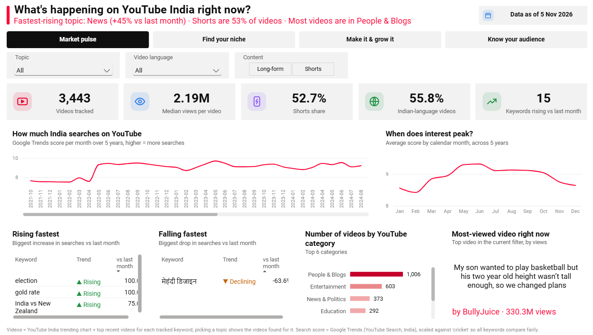
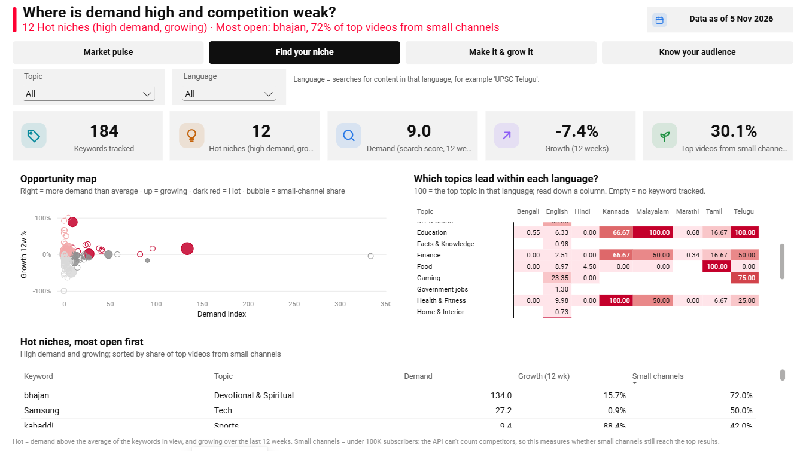
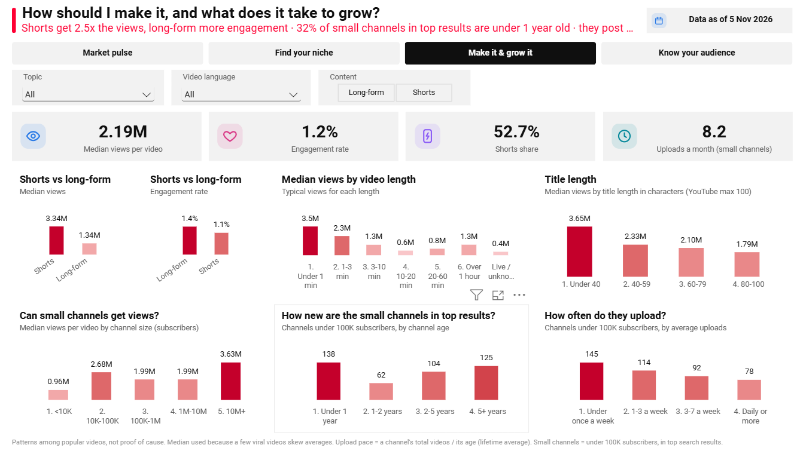
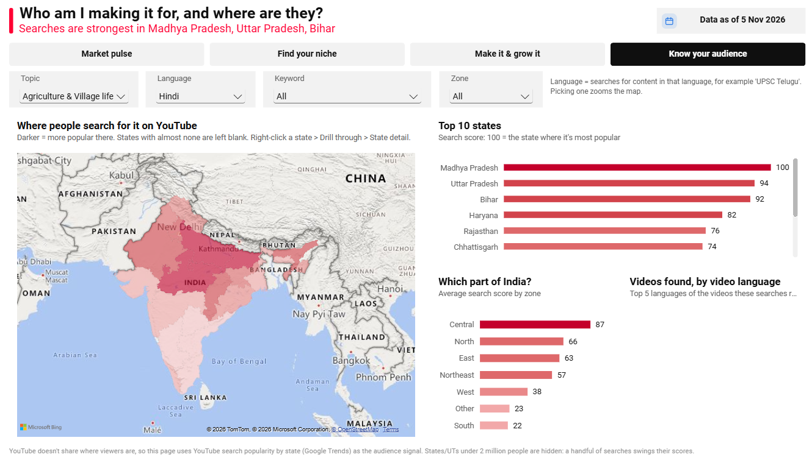
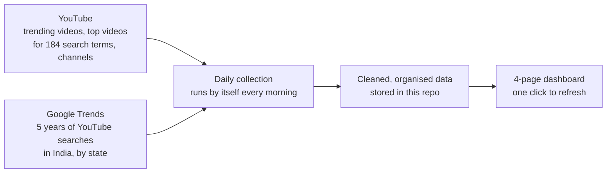

# India YouTube Trends

**Know what to make before you hit record.**
A free dashboard that tells someone starting a YouTube channel in India what people want to watch, which topics are growing, where competition is weak, and where their audience lives. Built on live public data, refreshed every day.

---

## 1. Who's behind it

**Kammala Kalyan** ([@kammala-kalyan](https://github.com/kammala-kalyan)): designed and built India YouTube Trends end to end, from the question it answers to the daily data pipeline, the data model and the dashboard.

---

## 2. The problem

Every month, thousands of people in India start a YouTube channel, and most of them choose a topic on **gut feeling**.

A new creator has no good way to answer the questions that decide their channel's future:

- What are people in India actually searching for, and is it **growing or dying**?
- Which topics have **demand, but aren't already owned by big channels**?
- Should I make **Shorts or long videos**? In **Hindi, English or my own language**?
- Can a **brand-new, small channel** really get views?
- **Where in India** is my audience?

The tools that exist answer these questions only **after** you've started a channel (your own analytics), or only for **one search term at a time**, mostly from an English, global point of view.

---

## 3. The solution

**India YouTube Trends** answers all of these questions in one place, **before you upload anything**, and for **India specifically**: 26 topic groups, 10 languages and every region.

It walks a creator through four decisions, one page each:

| Step | The question | What the page shows |
|---|---|---|
| 1 | **What's happening right now?** | What India searches for on YouTube, what's rising and falling, when topics peak in the year |
| 2 | **Where should I start?** | Topics with high demand that are growing, and where small channels still reach the top results |
| 3 | **How should I make it, and what does it take to grow?** | Shorts vs long videos, ideal length and title length, how new and how active successful small channels are |
| 4 | **Who is my audience, and where are they?** | A map of India showing where each topic is most popular, by state and region |

---

## 4. The product

**Page 1: Market pulse.** *"What's happening on YouTube India right now?"* A live headline sums up the market: the fastest-rising topic, how much is Shorts, and the biggest category. Below it: 5 years of search interest, the months when interest peaks, and the keywords rising and falling fastest.

**Page 2: Find your niche.** *"Where is demand high and competition weak?"* Every topic is placed on an opportunity map. The dark red corner is **Hot**: high demand and growing. The table lists those Hot niches, ranked by how often **small channels** still make it into the top results, the best sign that a newcomer can break in.

**Page 3: Make it and grow it.** *"How should I make it, and what does it take to grow?"* Shorts vs long videos, the video and title lengths that get the most views, and what successful small channels look like: how old they are and how often they post.

**Page 4: Know your audience.** *"Who am I making it for, and where are they?"* A map of India shaded by how popular the topic is in each state. Pick a language such as Telugu and the map zooms to where those viewers are.

---

## 5. How it works

- **Two public sources:** YouTube's official data and Google Trends for YouTube searches. You don't need a YouTube channel to use it.
- **Fully automatic:** a scheduled job collects fresh data **every morning at 9:00 AM** on GitHub's servers, with no laptop and no manual steps. If a source fails, the previous data is kept and the owner gets an email.
- **Fair comparisons:** search scores from different topics, days and languages are put on one common scale, so a Telugu education search and a cricket search can be compared honestly.
- **Built for India:** regional searches are tracked the way people actually type them ("UPSC Telugu", "share market Tamil"), and video languages are detected even when titles are in English.

---

## 6. What it has already found

*From the data as of 6 November 2026. The numbers keep updating every day.*

- **Shorts get about 2.5x more views** than long videos, but **long videos get more engagement** (likes and comments per view). Shorts bring reach; long videos build a loyal audience.
- **Small channels can win.** Channels with 10K–100K subscribers get **more views per video** than channels with 100K–10M.
- **A third of the small channels** that reach the top search results are **less than a year old**, and they post **about twice a week**.
- **Short titles work better.** Videos with titles under 40 characters get about **2x the views** of those with 80–100 characters.
- **Regional demand is concentrated.** Searches like "UPSC Telugu" come almost entirely from Andhra Pradesh and Telangana, so language and location go hand in hand.

These are patterns among popular videos, not guarantees, but they're a far better starting point than a guess.

---

## 7. Why it's different

| | India YouTube Trends | Your own YouTube analytics | Google Trends | Keyword browser extensions | Channel stats sites |
|---|---|---|---|---|---|
| Works **before** you start a channel | ✅ | ❌ only for your own channel | ✅ | ⚠️ mostly for existing channels | ✅ |
| Search demand **and** what videos win | ✅ | ❌ | ❌ searches only | ⚠️ keyword scores | ❌ channel numbers only |
| Shows where **small channels** can break in | ✅ | ❌ | ❌ | ❌ | ❌ |
| **Indian languages** and **states** | ✅ 10 languages, by state | ❌ | ⚠️ one term at a time | ⚠️ mostly global, English-first | ❌ |
| Free, open, updated daily | ✅ | ✅ | ✅ | ⚠️ often paid | ✅ |

---

## 8. By the numbers

| | |
|---|---|
| **184** search terms | across **26** topics, from Education and Finance to Devotional and Gaming |
| **10** languages | English, Hindi, Telugu, Tamil, Kannada, Malayalam, Bengali, Marathi, Gujarati, Punjabi |
| **5 years** | of weekly YouTube search history |
| **Thousands** of videos and channels | collected every day, and the history keeps growing |
| **36** states and union territories | in the search data, with the audience map focused on the larger ones |
| **4** pages | one per decision a new creator has to make |

---

## 9. What it costs to run

**₹0.** It runs entirely on free public data (YouTube's free daily quota and Google Trends) and free automation (GitHub Actions), and the dashboard opens in the free Power BI Desktop. It needs no server, subscription or maintenance.

---

## 10. What's next

- **Video growth speed:** how fast videos gain views in their first days, once a few weeks of daily snapshots have built up.
- **More regional search terms**, added as the built-in keyword test confirms they have enough search volume.
- **A shareable online version** of the dashboard, so anyone can explore it without installing anything.

**Feedback is welcome.** If you're a creator, tell me which question you'd want answered next.

---

### Technical details

How to open the dashboard, how the daily pipeline works, how to run it yourself, the data model and data limits: **[docs/HOW_TO_USE.md](docs/HOW_TO_USE.md)**

The full architecture and pipeline, from YouTube and Google Trends to the dashboard, explained step by step in plain words: **[docs/ARCHITECTURE.md](docs/ARCHITECTURE.md)**

Everything technical in Power BI: tools, data loading, the data model, every DAX formula and the design strategies: **[docs/POWER_BI_TECHNICAL.md](docs/POWER_BI_TECHNICAL.md)**
