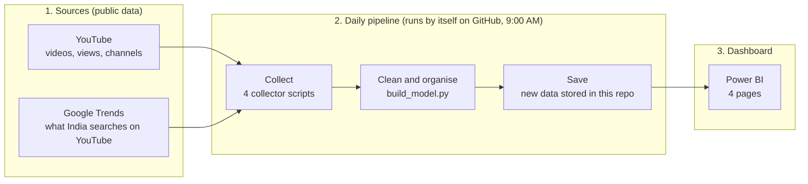
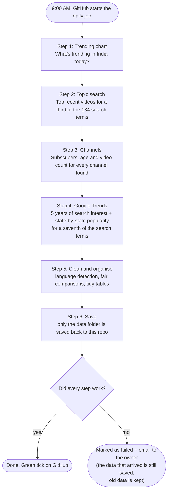
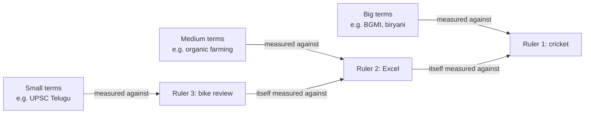
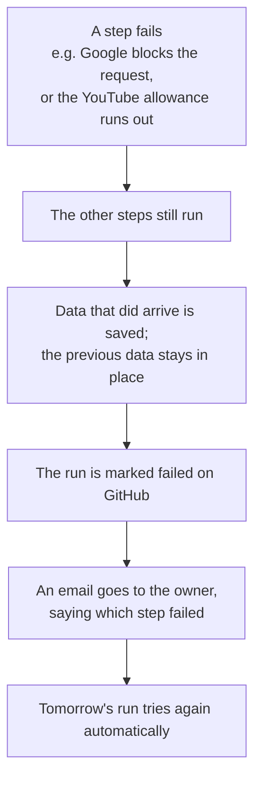
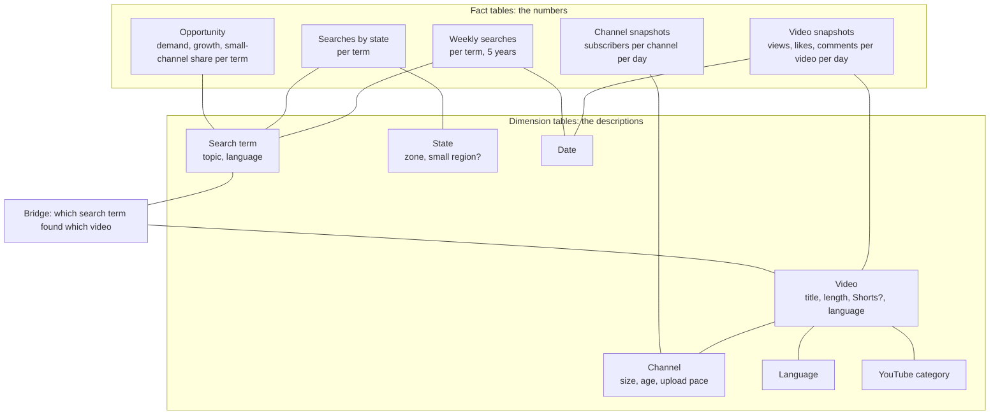

# How India YouTube Trends works: architecture and pipeline

This page explains, in plain words, how the data travels from YouTube and Google to the dashboard, every single day, without anyone touching it. No technical background needed. (For setup steps, see [HOW_TO_USE.md](HOW_TO_USE.md).)

---

## The big picture

Think of it like a **newspaper**:
- **Reporters** go out every morning and collect facts (the data collectors).
- An **editor** checks, cleans and organises everything into neat sections (the data builder).
- The **printed paper** is what readers see (the dashboard).

**In one sentence:** every morning a robot on GitHub collects fresh YouTube and Google Trends data, cleans it, saves it in this repository, and the Power BI dashboard reads it from there when you click Refresh.

---

## Where everything lives

| What | Where | In plain words |
|---|---|---|
| The list of topics to track | [`keywords.py`](../keywords.py) | 184 search terms in 26 topics, e.g. "UPSC Telugu", "biryani", "BGMI" |
| The collectors | `fetch_trending.py`, `fetch_topics.py`, `fetch_channels.py`, `fetch_trends.py` | Each one fetches one kind of data |
| The conductor | [`run_daily.py`](../run_daily.py) | Runs the collectors and the builder in the right order |
| The builder | [`build_model.py`](../build_model.py) | Cleans the raw data and turns it into tidy tables |
| The schedule | [`.github/workflows/daily.yml`](../.github/workflows/daily.yml) | Tells GitHub: "run the conductor every day at 9:00 AM" |
| Raw data (each day's collection) | [`data/`](../data) | One file per day per source, never deleted |
| Clean tables for the dashboard | [`data/model/`](../data/model) | 13 tidy tables Power BI reads |
| The dashboard | [`Dashboards/India YouTube Trends.pbip`](../Dashboards) | The 4-page Power BI report |
| The secret key | GitHub secret `YOUTUBE_API_KEY` | The password for YouTube's data, never written in the code |

---

## The daily run, step by step

Every day at **9:00 AM India time**, GitHub starts a fresh computer in the cloud and runs these steps. The whole run takes a few minutes.

### Step 1: Trending chart (`fetch_trending.py`)
Asks YouTube: *"What's on India's trending list today?"*, overall and for each category (music, gaming, news and so on). This shows what India is watching right now.

### Step 2: Topic search (`fetch_topics.py`)
For each search term, asks YouTube: *"What are the most-viewed videos from the last 30 days for this term?"* (for example "share market Telugu"), then fetches their views, likes, comments, length and language.
- YouTube gives a free daily allowance (10,000 "units"), and each search costs 100. So the 184 terms are split into **3 groups, one group per day**: every term is refreshed every 3 days, using about 6,200 units a day.
- Regional terms are searched **in that language**, so "UPSC Telugu" returns Telugu videos.

### Step 3: Channels (`fetch_channels.py`)
For every channel behind those videos: subscribers, total videos and when it started. This is how the dashboard knows whether a video comes from a **small channel** (under 100K subscribers) and how often successful channels post.

### Step 4: Google Trends (`fetch_trends.py`)
Asks Google: *"How much did India search for this on YouTube, every week for 5 years, and in which states?"*
- To stay polite (Google blocks too many requests), it does **a seventh of the terms each day**, so every term is refreshed once a week. Brand-new terms are done straight away.
- It also fetches **cricket's popularity in each state** once a day, which is used to make state comparisons fair (see "Fair comparisons" below).

### Step 5: Clean and organise (`build_model.py`)
The "editor". It reads **every day's raw files** (old and new) and produces 13 tidy tables. Along the way it:
- **Detects each video's language**, even when the title is in English (see below).
- **Puts all search scores on one fair scale** (see below).
- Works out each topic's **demand** (recent searches), **growth** (last 12 weeks vs the 12 before) and **small-channel share** (how many of its top videos come from small channels).
- Groups videos by **length**, **title length**, **Shorts vs long**, and channels by **size**, **age** and **upload pace**.

### Step 6: Save
Only the `data/` folder is saved back to this repository, signed by GitHub's robot account (`data: YYYY-MM-DD`). Code and the dashboard are never touched by the robot.

### Step 7: The dashboard reads it
Power BI reads the clean tables **straight from this repository on the internet**. Anyone who opens the dashboard and clicks **Refresh** gets the latest data, with no setup.

---

## The weekly rhythm

Because of the free limits, not everything is refreshed every day. Over a week, everything is:

| What | How often |
|---|---|
| Trending chart | every day |
| Channel stats | every day |
| Top videos per search term | every 3 days (a third of the terms per day) |
| Google Trends search history and states | every 7 days (a seventh of the terms per day) |
| Cricket's state profile (for fair state comparisons) | every day |

History keeps growing: the YouTube data has no "history" button, so **every day's snapshot is kept forever**.

---

## Fair comparisons: the clever part, in plain words

Google Trends has a quirk: it scores every search **0–100 against the biggest term in the same question**, and you can only ask about 5 terms at a time. So a "50" in one question and a "50" in another mean different things.

**The fix: a ruler that's in every question.**
- Every question includes **cricket**, India's biggest search, as a fixed **ruler**. If cricket scores 80 in one question and 40 in another, everything in the second question is doubled. Now all scores are on the same scale.
- **Small terms are too tiny next to cricket** (they round to 0), like measuring a grain of rice with a metre stick. So they get **smaller rulers**, used in a chain: cricket → **"Excel"** (about a fifth of cricket) → **"bike review"** (about a twentieth of Excel). Each ruler is measured against the one above it, so every term still ends up on the cricket scale.
- **The pipeline picks the ruler automatically.** If a term comes back as 0, the next day it's measured with the next smaller ruler.
- **The rulers must be searched all over India**, because state results are measured through them too. (A ruler only searched in one state would leave every other state blank.)

**Fair state comparisons.** Some states (like Mizoram) search very little cricket, so measuring topics against cricket there makes every topic look huge. So the pipeline also fetches **how popular cricket is in each state**, and converts every score into **"how popular is this topic within that state's own searches"**. States and union territories with under 2 million people are hidden on the map, because a handful of searches swings their scores.

---

## Language detection, in plain words

Many Telugu, Tamil or Kannada videos have **English titles**, so a video's language can't be judged by its title alone. Each video goes through these checks, and the first one that gives an answer wins:

1. **The language set on the audio** by the creator (if it's an Indian language).
2. **The script of the title** (Telugu letters → Telugu).
3. **A language named in the title or tags** ("Telugu", "#tamil", "Hindi dubbed").
4. **English audio** set by the creator.
5. **The default language** set by the creator.
6. **English letters** in the title (a weak guess).
7. Finally, weak guesses are corrected with **the channel's main language**: if most of a channel's videos are clearly Telugu, its unclear ones are Telugu too.

---

## When something goes wrong

The pipeline is built so that **a bad day never damages the data you already have**.

Extra safety nets:
- **Nothing is ever deleted.** Every day's raw data stays in `data/`.
- **The quota guard** stops YouTube searches before the free daily limit runs out.
- **Too many failures in a row** (Google blocking) → it stops early instead of wasting the run.
- **File-size check:** if any data file grows close to GitHub's 100 MB limit, the run warns by failing early.
- **The secret key** lives only in GitHub's secret store, never in the code.

---

## The tidy tables (data model)

The builder organises everything as a **star**: "fact" tables hold the numbers, and "dimension" tables describe them (which video, which channel, which state, which day). This shape makes the dashboard fast and the filters work across every page.

The **bridge** is what lets one "Topic" filter control both kinds of data: picking "Education" shows Education searches **and** the videos found by searching Education terms.

---

## The full journey of one search term

Following **"UPSC Telugu"** from start to dashboard:

1. It's listed in `keywords.py` under **Education**, tagged as **Telugu**.
2. Every 3 days, **Step 2** searches YouTube for it in Telugu and saves the top 50 recent videos.
3. **Step 3** fetches the channels behind those videos (how big, how old, how often they post).
4. Once a week, **Step 4** asks Google Trends about it. It's too small next to cricket, so it's measured with the smallest ruler, "bike review".
5. **Step 5** converts its score to the cricket scale, works out its demand and growth, checks how many of its top videos come from small channels, and marks those videos as Telugu.
6. **Step 6** saves it all to the repo.
7. On the dashboard: it appears in **Education × Telugu** on page 2, its videos count as **Telugu** on pages 1 and 3, and on page 4 picking **Telugu** zooms the map to **Andhra Pradesh and Telangana**.
